  

 

## About

 

## Stack

 

 

## Activity

  

<a>
<picture>
  <source media="(prefers-color-scheme: dark)" srcset="https://raw.githubusercontent.com/AndrewMitchel/AndrewMitchel/output/github-contribution-grid-snake-dark.svg">
  
</picture>
</a>

 

## Connect

<!-- Ganti href dengan akun aslimu, atau hapus baris yang nggak dipakai -->

 

